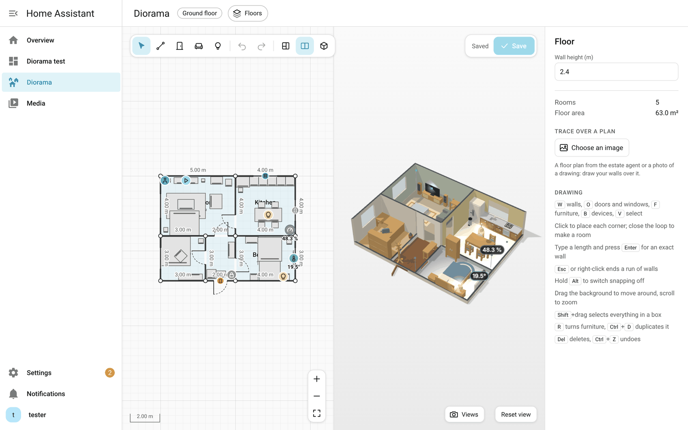
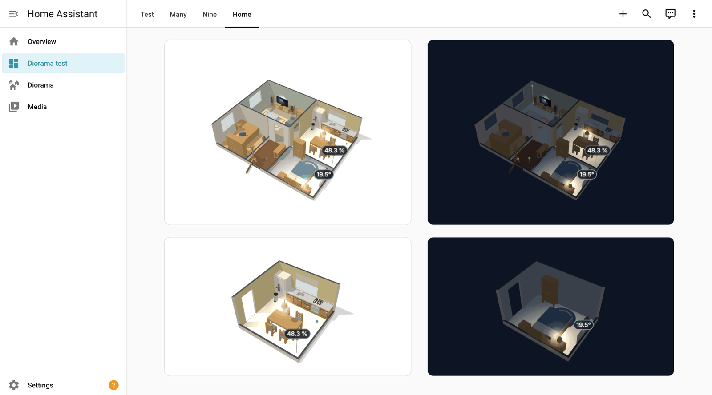
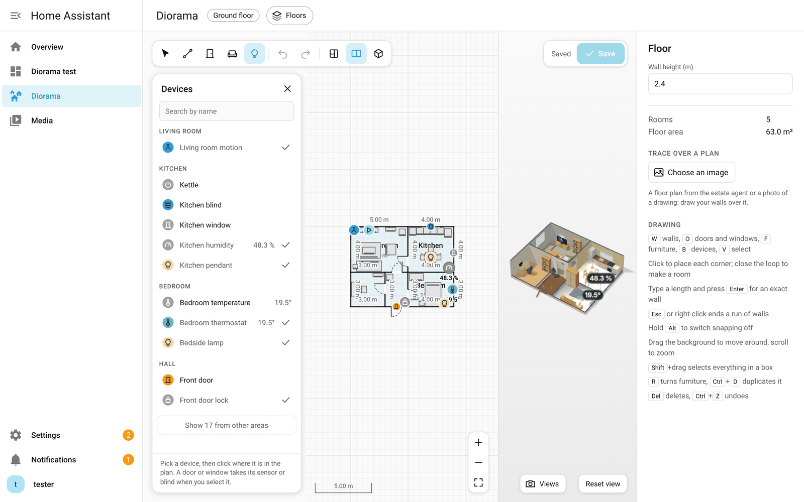

# Diorama

Your house in 3D in Home Assistant. Draw it floor by floor and room by room, furnish it, and put your devices where they really are. Lights glow when they are on, blinds go up and down, doors swing open, rooms take the colour of their temperature, and a tap works whatever it lands on. The same house is a panel for drawing and a dashboard card for the whole house, one floor or one room.





## What it does

- **Draw**: walls with snapping and typed lengths, rooms found for you, single and double doors, archways and windows, several floors joined by stairs, and a plan image to trace over.
- **Furnish**: 111 low-poly pieces are included, and you can add `.glb` models of your own. Stretch any piece to fit, and stand small things on tables, worktops and shelves.
- **Place devices**: lights, switches, fans, blinds and covers, door and window sensors, thermostats and temperature sensors, motion and presence, media players, locks, and any other sensor as a reading.
- **Use it**: tap a light, switch or blind to work it; press and hold anything for its details. A garage door or gate asks first, and a lock is never worked by a tap.
- **Dashboard card**: the whole house, a floor or a room, from any saved camera angle, on any device. It follows the sun, so the house is dark at night with the lights that are on showing.

Drawing needs a desktop-sized screen and an administrator. Looking and tapping work for everyone, on phones too.

## Install

Diorama is a custom integration for Home Assistant 2026.11 or later, installed through the Marketplace. It is not in the catalogue yet, so add it from a link:

[](https://my.home-assistant.io/redirect/marketplace_repository/?owner=marctew&repository=HA-Diorama&category=integration)

Or by hand: go to **Settings** > **Marketplace**, select **Add from link**, enter `marctew/HA-Diorama` with the type **Integration**, and install it. Then add the integration; there is nothing to configure:

[](https://my.home-assistant.io/redirect/config_flow_start/?domain=diorama)

An update to Diorama needs a restart of Home Assistant; the first install does not.

## Draw your house

**Diorama** in the sidebar opens the panel. The plan is on the left and the same floor in 3D on the right.

| Key | Tool |
|---|---|
| `W` | Walls: click each corner and close the loop to make a room. Type a length and press Enter for an exact wall. |
| `O` | Doors and windows: click a wall. |
| `F` | Furniture: pick a piece, click to place it, `R` turns it. |
| `B` | Devices: pick one, then click where it is. |
| `V` | Select, move and delete. |

- Select a room to name it, choose its floor and wall colour, and link it to a Home Assistant area. Its devices are then listed first.
- A device dropped on furniture that suits it becomes that piece: a light on a lamp, a media player on the TV, a thermostat on the radiator.
- A door or window takes a sensor or a blind of its own: select it and choose one. A door with a sensor swings open and shut; one without stands open. A window with a blind shows how far down it is.
- Select a door to give it two leaves, hang it from the other side or open it the other way. Drag either end of a door or window to change its width.
- Select a piece of furniture and drag its handles to stretch it, or type its size on the right. Small things (lamps, a microwave, a laptop) stand on whatever table or unit you drop them on, and go with it when it moves. **Off the floor** puts anything at a height: a wall unit, a mirror, a picture.
- Stairs open the floor above them, and show coming up through it. For a stairwell of another shape, a gallery or a double-height room, select the room upstairs and tick **Open to the floor below**.
- With nothing selected, the panel on the right takes a floor plan image to trace over.
- **Floors** adds and arranges floors. **Views** on the 3D side saves camera angles for cards to use.



### Your own models

At the bottom of the furniture list, **Add a model** takes a binary glTF file (`.glb`). You are shown the model and asked for its real size, since files rarely say; set the one dimension you know and the others follow. It is kept without its textures, in flat colours, so it matches the rest and stays small. Only add models you have the right to use.

Models live in `diorama/models` in your configuration folder and are included in Home Assistant backups. Exporting a house does not include them.

## The card

Add the **Diorama** card to a dashboard and choose what it shows in its settings, or in YAML:

```yaml
type: custom:diorama-card
view: room            # house | floor | room
floor: f_ground       # for view: floor or room
room: r1              # for view: room
aspect_ratio: "16:9"
walls: auto           # auto lowers the walls in the way; full | low
interactive: true     # false: taps do nothing
controls: true        # false: the view cannot be turned or zoomed
day_night: true       # false: always daytime
floor_gap: 2.5        # house view: space the floors apart (metres)
camera: c_ab12cd34    # a saved view, easiest picked in the card's settings
```

Any number of cards can share a dashboard: they draw through one WebGL context, and a card that is off screen draws nothing.

## Good to know

- This is a first release. Keep an export of your house (it is in Home Assistant's backups too).
- Day and night take the top of the plan to be north.
- Lighting is drawn for looks, not simulated: a light washes the floor of its room.
- English only so far. The card and the 3D view are ready for translations (`frontend/src/locales`); the drawing panel is not yet.
- Removing the integration leaves your house, images and models where they are.

## Develop

Backend (Python 3.14):

```bash
pip install -r requirements-dev.txt
python -m pytest
ruff check . && ruff format --check .
```

Frontend (Node 22):

```bash
cd frontend
npm ci
npm run build       # writes custom_components/diorama/frontend/dist
npm test && npm run typecheck && npm run lint
```

To try it, link or copy `custom_components/diorama` into the `custom_components` folder of a Home Assistant configuration, build the frontend, restart, and add the integration. [SPEC.md](SPEC.md) has the design and what was learned building it.

A release is a published GitHub release whose tag equals `version` in `manifest.json`; an action builds the frontend and attaches `diorama.zip`, which is what the Marketplace installs.

## Licence

MIT. The bundled models, the libraries in the frontend and their licences are listed in [CREDITS.md](CREDITS.md).
